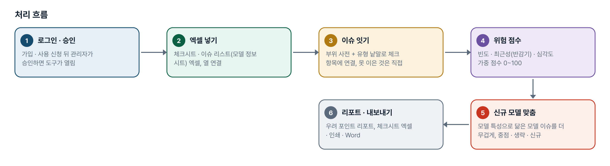
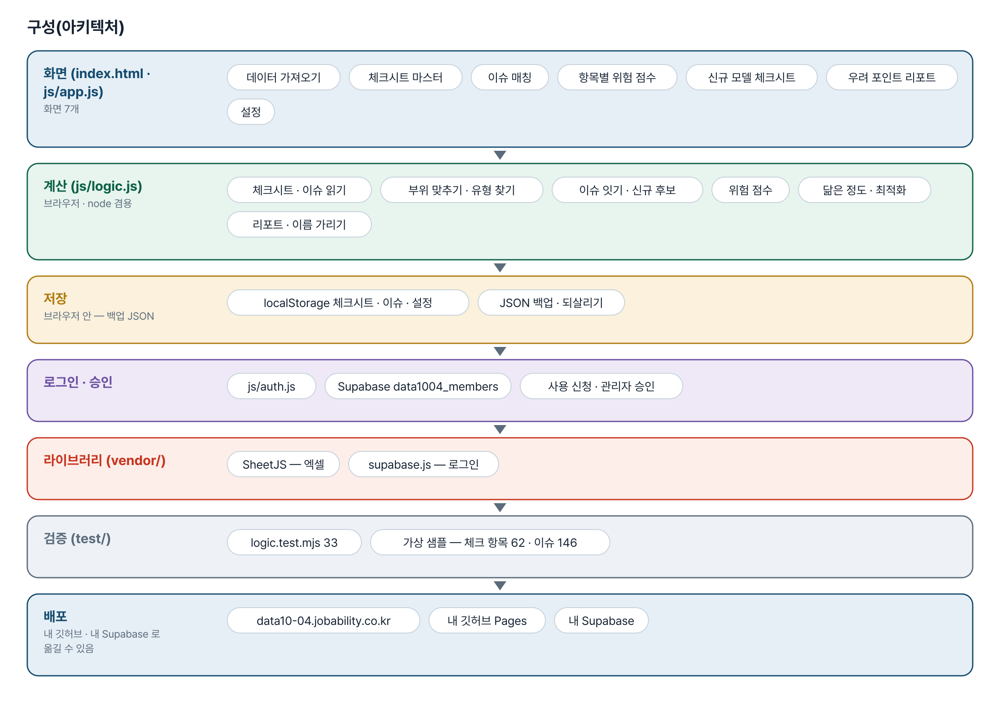
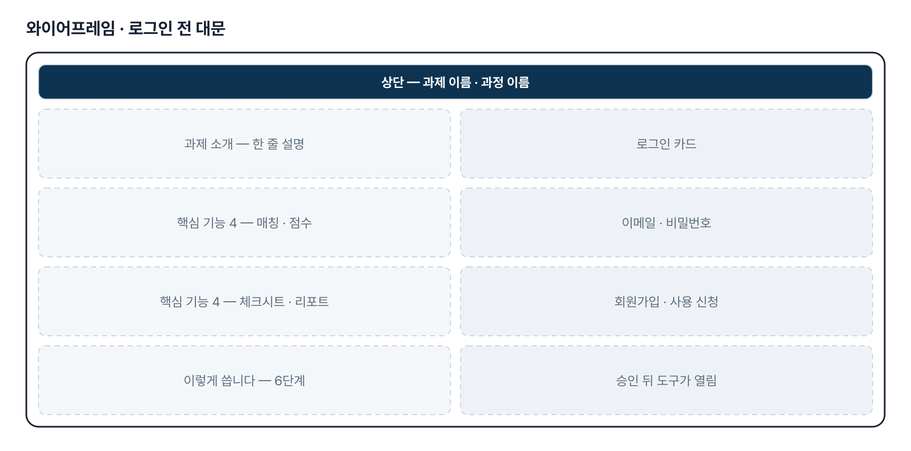
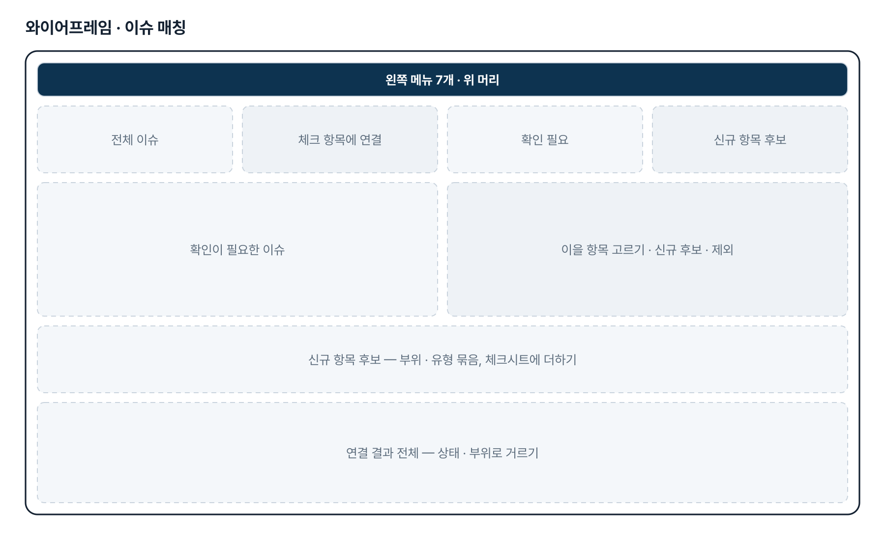
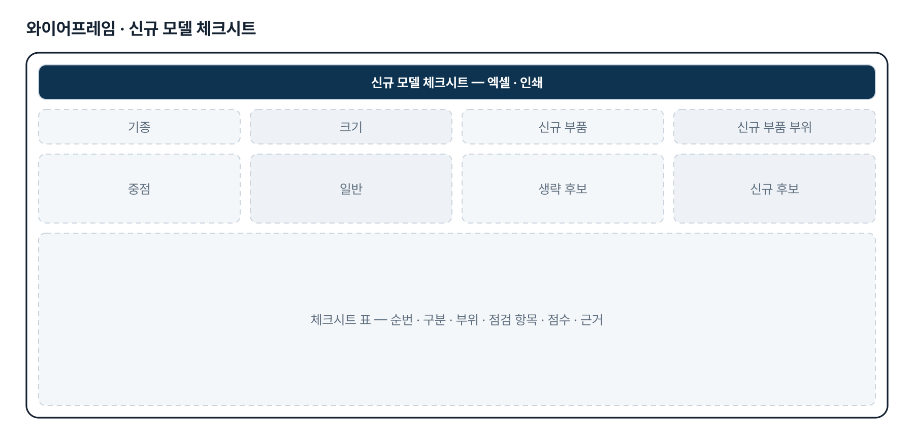
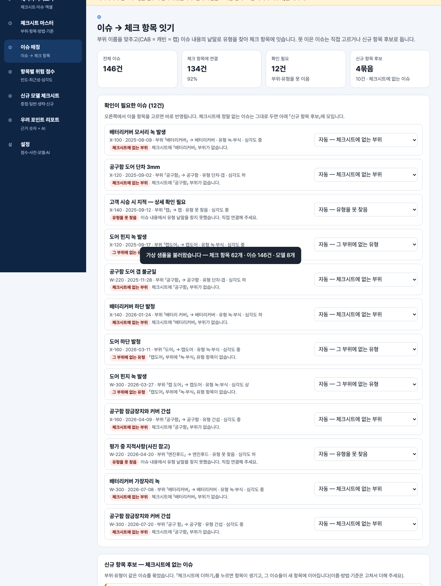

# 개발장비 외관평가 Agent — 프로젝트 기획서 v2.0

- 기획: 이은학 · 작성일 2026-11-10 · 현장 데이터 디지털화 전문가과정 · 2차수 프로젝트 04
- 바로 쓰기: https://data10-04.jobability.co.kr/
- 워드 판: `docs/기획서/data10-04_이은학_개발장비외관평가Agent_기획서_v2.0.docx`

## 개요

외관검사 체크시트와 이슈 리스트를 이어 항목별 이슈 빈도 · 위험 점수를 내고, 신규 개발모델용 체크시트와 이슈 발생 우려 포인트 리포트를 만드는 도구입니다.

### 배경 · 현재 업무
- 개발장비(개발 단계의 신규 모델)는 외관검사 체크시트로 외관 품질을 확인합니다.
- 체크시트 항목이 실제로 이슈가 자주 난 곳을 반영하지 못해, 모든 항목을 같은 무게로 봅니다.
- 과거 모델의 외관검사 이슈 리스트는 따로 쌓여 있어 체크시트와 하나씩 대조해야 합니다(가정).
- 새 개발모델의 특성(기종 · 크기 · 신규 부품)에 맞춰 어디를 더 볼지를 경험으로 정합니다(가정).

### 목표
- 이슈 리스트를 체크시트 항목에 이어 항목마다 실제 이슈 빈도를 보입니다.
- 개발모델 특성에 따라 체크시트를 최적화합니다 — 중점 · 일반 · 생략 후보 · 신규 항목 후보.
- 신규 개발모델의 이슈 발생 우려 포인트를 근거 숫자와 함께 냅니다.

## 요구사항과 구현

| 기획서 요구 | 구현 |
|---|---|
| 외관검사 체크시트에 실제 이슈 발생 빈도 반영 | 이슈 → 체크 항목 잇기(부위 + 점검 유형), 항목별 빈도 · 최근성 · 심각도 점수 |
| 개발모델에 따른 체크시트 최적화 | 기종 · 크기 · 신규 부품으로 닮은 정도 반영, 중점 · 일반 · 생략 후보 · 신규 후보, 엑셀 · 인쇄 |
| 이슈 발생 우려 포인트 산출 | 상위 우려 포인트 · 근거 숫자 · 대표 이슈, 문장은 AI 프롬프트(모델 이름 가림) |
| 체크시트에 없는 이슈 찾기 | (부위 · 유형)으로 묶은 신규 항목 후보, 더하면 그 이슈들이 새 항목에 이어짐 |
| 검사 결과(OK/NG) 입력 · 누적 | 2단계 |
| 실제 자료로 보정 | 2단계 — 실제 체크시트 · 이슈 리스트를 아직 받지 않아 가상 샘플로 만듦 |

## 주요 기능

- **이슈 매칭** — 부위 이름을 맞추고(CAB = 캐빈 = 캡) 이슈 내용의 낱말로 유형을 찾아 체크 항목에 잇습니다.
- **항목별 위험 점수** — 빈도 · 최근성 · 심각도를 합친 0~100 점수를 내고 기종 · 크기 · 신규 부품으로 거릅니다.
- **신규 모델 체크시트** — 신규 모델 특성으로 위험 항목을 앞으로 올려 중점 · 일반 · 생략 · 신규 후보로 나눕니다.
- **우려 포인트 리포트** — 상위 우려 포인트와 근거 숫자, 되풀이 항목, 신규 항목 후보를 정리합니다.
- **데이터 가져오기** — 체크시트 · 이슈 리스트 엑셀, 머리행 자동 찾기, 열 연결, 중복 제거, 모델 정보 시트.
- **체크시트 마스터** — 부위 · 점검 항목 · 검사 방법 · 판정 기준을 더하고 고치며 항목별 연결 이슈 수를 봅니다.
- **AI 문장 다듬기** — 계산된 사실만 담은 프롬프트, 모델 이름은 별칭으로 가리고 답에서 되돌립니다.
- **로그인 · 사용 승인** — 회사 메일이나 개인 메일로 가입하고 사용 신청 → 관리자 승인 뒤 씁니다.

## 처리 흐름(파이프라인)

1. **로그인 · 승인** — 가입 · 사용 신청 뒤 관리자가 승인하면 도구가 열림
2. **엑셀 넣기** — 체크시트 · 이슈 리스트(모델 정보 시트) 엑셀, 열 연결
3. **이슈 잇기** — 부위 사전 + 유형 낱말로 체크 항목에 연결, 못 이은 것은 직접
4. **위험 점수** — 빈도 · 최근성(반감기) · 심각도 가중 점수 0~100
5. **신규 모델 맞춤** — 모델 특성으로 닮은 모델 이슈를 더 무겁게, 중점 · 생략 · 신규
6. **리포트 · 내보내기** — 우려 포인트 리포트, 체크시트 엑셀 · 인쇄 · Word

## 구성(아키텍처)

- **화면 (index.html · js/app.js)** — 데이터 가져오기 · 체크시트 마스터 · 이슈 매칭 · 항목별 위험 점수 · 신규 모델 체크시트 · 우려 포인트 리포트 · 설정
- **계산 (js/logic.js)** — 체크시트 · 이슈 읽기 · 부위 맞추기 · 유형 찾기 · 이슈 잇기 · 신규 후보 · 위험 점수 · 닮은 정도 · 최적화 · 리포트 · 이름 가리기
- **저장** — localStorage 체크시트 · 이슈 · 설정 · JSON 백업 · 되살리기
- **로그인 · 승인** — js/auth.js · Supabase data1004_members · 사용 신청 · 관리자 승인
- **라이브러리 (vendor/)** — SheetJS — 엑셀 · supabase.js — 로그인
- **검증 (test/)** — logic.test.mjs 33 · 가상 샘플 — 체크 항목 62 · 이슈 146
- **배포** — data10-04.jobability.co.kr · 내 깃허브 Pages · 내 Supabase

## 화면 구성(와이어프레임)

## 규칙 · 판정 기준

- 이슈와 체크 항목은 「부위 + 점검 유형」으로 잇습니다. 부위는 사전 · 위치 낱말 · 괄호 빼기로 맞추고, 유형은 이슈 글의 낱말로 찾습니다.
- 그 부위에 그 유형 항목이 없으면 낱말이 겹쳐도 잇지 않고 신규 항목 후보로 보냅니다. 직접 연결이 자동보다 앞섭니다.
- 위험 점수 = 빈도 · 최근성(Σ 0.5^(경과일/반감기)) · 심각도(상3 · 중2 · 하1)를 각각 최댓값 100 으로 맞춘 가중 평균(기본 40 · 30 · 30).
- 기준일은 오늘이 아니라 이슈 가운데 가장 늦은 발생일입니다.
- 닮은 정도 — 특성이 다른 모델의 이슈는 반영률을 곱합니다(기종 ×0.5, 크기 ×0.7, 신규 부품 유무 ×0.5). 신규 부품 부위는 ×1.5.
- 중점 = 40점 이상, 생략 후보 = 이슈 0건이고 필수 · 신규 부품 부위가 아닌 항목. 판단은 담당자가 합니다.

## 검증

- 계산 규칙 테스트 33개 통과
- 부위 다른 이름 사전 · 닮은 정도 · 모델 이름 가리기 · 위치 낱말 빼기를 일부러 끄면 시험이 실패하는 것을 확인했습니다.
- 판 맞추기 시험(index.html ?v= · logic.js · app.js 가 같은 판)이 들어 있습니다.

## 이번 판에서 하지 않는 것

- 업무 자료(체크시트 · 이슈 리스트)는 아직 팀 공유 DB 가 아니라 각자의 브라우저 localStorage 에 저장합니다.
- 실제 체크시트 · 이슈 리스트를 아직 받지 않아 가상 샘플로 만들었습니다. 잇는 키 · 가중치 · 생략 기준은 가정입니다.
- 검사 결과(OK/NG) 입력과 이슈 자동 누적은 하지 않습니다.
- 외관 이슈 사진은 다루지 않습니다.

## 다음 단계

- 실제 체크시트 · 이슈 리스트로 열 연결 · 부위 사전 · 유형 사전 · 가중치 보정
- 팀 공유 저장 — 체크시트 · 이슈 리스트를 Supabase 에 두고 승인된 팀원이 함께 보기
- 검사 결과(OK/NG) 입력 → 이슈 리스트 자동 누적
- 이슈 사진 붙이기, 판정 기준서 기반 질의

## 버전 이력

- **v2.0** (2026-11-10) — 최종 기획서 — 파이프라인 · 아키텍처 · 와이어프레임 정리 / 로그인 · 사용 신청 · 관리자 승인(요청자 Supabase 로 옮길 수 있게) / 로그인 전 대문
- **v1.1** (2026-10-27) — 판 맞추기 — css · js 판 질의 ?v= · fresh-guard · 판 확인 시험
- **v1.0** (2026-10-20) — 1단계 — 체크시트 · 이슈 리스트 가져오기 · 이슈 잇기 · 위험 점수 · 신규 모델 체크시트 · 우려 포인트 리포트 · AI 프롬프트
